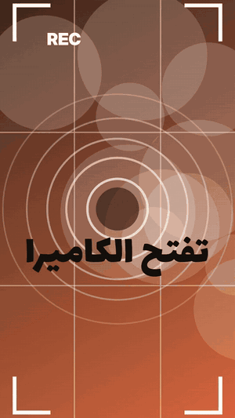

<div align="center">

# 🎬 مساعد صانع المحتوى المبتدئ · reel-starter

**مهارة مجانية لـ Claude Code: تعطيها فكرتك، وتعطيك بطاقة ريل جاهزة للتسجيل.**
**A free Claude Code skill for beginner creators: give it an idea, get a reel card that is ready to record.**

🆓 مهارة مجانية · Free skill — by م. ريم الفضلي · [@iconReem](https://www.instagram.com/iconreem)

</div>

---

## العربية

### شنو هي؟
«reel-starter» مهارة لـ Claude Code تحوّل «عندي فكرة وما أعرف شلون أقولها» إلى **بطاقة ريل** كاملة: خطّاف، سكربت قصير، لقطات، وصف للمنشور، وفحص قبل لا تسجل. ملفات نصية بس، تقدر تقراها كلها قبل لا تستخدمها.

### 🎬 شنو تشبه (نموذج)

<div align="center">

[](https://reemalfadly.github.io/reel-starter/media/watch.html)

▶️ اضغط على الصورة تشوف الفيديو كامل (29 ثانية)

</div>

### شنو تعطيك

| | |
|---|---|
| 🪝 **3 خطّافات** | ثلاث بدايات مختلفة لريلك، وترشّح لك وحدة وتقول ليش |
| 📝 **سكربت 20 ثانية** | خطّاف، بعده 4 جمل كل وحدة تكمل اللي قبلها، بعدها دعوة وحدة |
| 🎥 **شنو تصور** | 3 أو 4 لقطات بسيطة تتصور بالفون بدون معدات |
| ✍️ **وصف المنشور** | سطرين إلى 3 يكملون الفكرة |
| ✅ **فحص قبل التسجيل** | 8 أسئلة تتأكد فيها إن السكربت واضح وصادق |

### وتقدر تطلب منها بعد

| تقول | تسوي |
|---|---|
| 💡 **«عطني أفكار»** | 10 أفكار لمجالك، كل فكرة بسطر |
| 🔧 **«حسّن هالسكربت»** | تلصق سكربتك وتقول لك شنو يتعدل، مع الجملة البديلة |
| 🗓 **«خطة أسبوع»** | 7 أفكار منوعة (تعليم، قصة، رأي، سؤال للجمهور) |

### شنو ما تسوي
- ما تخترع أرقام ولا دراسات. المعلومة اللي مو متأكدة منها تعلّمها لك بـ `[تأكد: …]` وانت تتحقق.
- ما توعدك بانتشار ولا بأرباح.
- ما تنشر ولا ترسل ولا تجدول شي.
- ما تمنتج ولا تصمم. ناتجها نص بس.
- ما تشغّل برامج ولا تتصل بالإنترنت.

### شنو تحتاج
- برنامج **Claude Code** على جهازك (ويندوز أو ماك).
- اشتراك Claude المدفوع اللي يتطلبه Claude Code. المهارة نفسها مجانية.

### التنزيل (4 خطوات)
1. فوق بهالصفحة اضغط الزر الأخضر **Code**، واختار **Download ZIP**.
2. فك الملف المضغوط. بتلقى مجلد اسمه `reel-starter-main`، وداخله مجلد اسمه `reel-starter`.
3. انسخ المجلد الداخلي `reel-starter` لمجلد المهارات على جهازك:
   - **ويندوز:** `C:\Users\اسمك\.claude\skills\`
   - **ماك:** `~/.claude/skills/`

   إذا مجلد `skills` مو موجود، سوّه.
4. سكّر Claude Code وافتحه من جديد.

المسار النهائي لازم يكون جذي: `.claude/skills/reel-starter/SKILL.md`

### شلون تستخدمها
اكتب بكلامك العادي وبلهجتك، مثل:

> مجالي العقار، وجمهوري شباب يشترون أول شقة، وأتكلم كويتي. أبي سكربت ريل عن أخطاء المعاينة.

> عطني 10 أفكار لحساب عن اللياقة للمبتدئين.

> حسّن هالسكربت: (والصق سكربتك)

> خطة أسبوع لحساب طبخ.

إذا ما ذكرت مجالك وجمهورك ولهجتك، تسألك عنهم. وإذا الفكرة ناقصها شي أساسي، تسألك سؤال واحد قبل لا تكتب.

### مثال
بطاقة ريل كاملة من البداية للنهاية: [examples/example.md](reel-starter/examples/example.md)

### الخصوصية
- ما فيها مفاتيح ولا حسابات ولا اتصال بأي موقع.
- أي نص تلصقه لها تعتبره بيانات مو تعليمات، وإذا لقت فيه أوامر موجهة لها تنبهك وما تنفذها.

### بنية المشروع
```
reel-starter/              المستودع
├── README.md              هذا الملف
├── CHANGELOG.md
├── LICENSE                MIT
├── media/                 نموذج العرض: demo.mp4 · watch.html · preview.gif · poster.jpg
└── reel-starter/          ← المجلد اللي تنسخه لمجلد المهارات
    ├── SKILL.md           التعليمات اللي يمشي عليها Claude
    ├── reference/
    │   ├── hooks.md       12 نوع خطّاف ومتى يصلح كل نوع
    │   └── checklist.md   8 أسئلة قبل التسجيل
    └── examples/
        └── example.md     بطاقة ريل كاملة
```

---

## English

### What is it?
**reel-starter** is a Claude Code skill that turns "I have an idea but don't know how to say it" into a complete **reel card**: hooks, a short script, shots, a caption and a pre-recording check. It is plain text files you can read in full before using.

### 🎬 What it looks like (demo)

<div align="center">

[](https://reemalfadly.github.io/reel-starter/media/watch.html)

▶️ Click the image to watch the full video (29 seconds, Arabic voiceover)

</div>

### What you get

| | |
|---|---|
| 🪝 **3 hooks** | Three different openings for your reel, with one recommended and the reason why |
| 📝 **A 20-second script** | A hook, four sentences that each build on the last, and one call to action |
| 🎥 **What to film** | 3 or 4 simple shots you can take with your phone |
| ✍️ **Caption** | Two or three lines that complete the idea |
| ✅ **Pre-recording check** | Eight questions that confirm the script is clear and honest |

### You can also ask it for

| Say | It does |
|---|---|
| 💡 **"Give me ideas"** | 10 ideas for your niche, one line each |
| 🔧 **"Improve this script"** | Paste your script and it tells you what to change, with a replacement sentence |
| 🗓 **"A week plan"** | 7 varied ideas (teaching, story, opinion, audience question) |

### What it does not do
- It does not invent numbers or studies. Anything it is unsure of is marked `[تأكد: …]` (meaning "verify this") for you to check.
- It does not promise reach or income.
- It does not publish, send or schedule anything.
- It does not edit video or design. Its output is text only.
- It runs no programs and makes no network calls.

### Requirements
- **Claude Code** on your computer (Windows or Mac).
- The paid Claude subscription that Claude Code requires. The skill itself is free.

### Install (4 steps)
1. Click the green **Code** button at the top of this page and choose **Download ZIP**.
2. Unzip it. You get a folder named `reel-starter-main`, and inside it a folder named `reel-starter`.
3. Copy the inner `reel-starter` folder into your skills folder:
   - **Windows:** `C:\Users\YourName\.claude\skills\`
   - **Mac:** `~/.claude/skills/`

   If the `skills` folder does not exist, create it.
4. Close Claude Code and open it again.

The final path should look like this: `.claude/skills/reel-starter/SKILL.md`

### How to use it
Write in your own words, for example:

> My niche is real estate, my audience is young first-time buyers. Write me a reel script about mistakes people make when viewing an apartment.

> Give me 10 content ideas for a beginner fitness account.

> Improve this script: (paste your script)

> A week plan for a cooking account.

If you do not mention your niche, your audience and the language or dialect you speak, it asks. If the idea is missing something essential, it asks one question before writing.

### Language
The skill's instructions and its example are written in Arabic, and it is built to reply in the language and dialect you write in. It has been tested in Arabic only, so English output is untested.

### Example
A complete reel card from start to finish: [examples/example.md](reel-starter/examples/example.md)

### Privacy
- No keys, no accounts, no connection to any site.
- Any text you paste is treated as data, not instructions. If it contains commands aimed at the AI, the skill warns you and does not follow them.

### Project structure
See the tree in the Arabic section above.

### License
MIT. Use it, change it and share it freely. See [`LICENSE`](LICENSE).

---

Made by **iconReem** · Instagram [@iconreem](https://www.instagram.com/iconreem)
